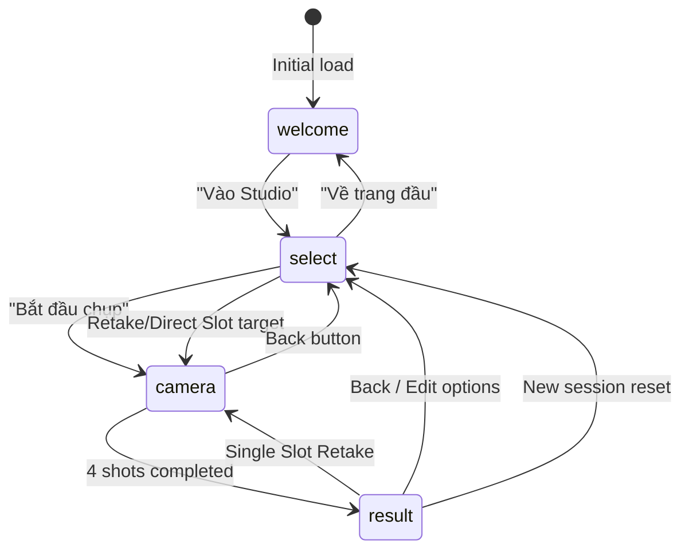

# Architecture & State Machine

This document details the internal architecture, state machine, and data flow of `moyoo`.

---

## 1. Application State Machine
The core navigation operates as a single-page finite state machine managed by `step`:



| Step (`Step`) | UI Purpose | Key Interactions |
| :--- | :--- | :--- |
| `'welcome'` | Editorial entrance screen | Live interactive photostrip swatch preview, feature bento cards, Enter Studio CTA. |
| `'select'` | Darkroom Studio craft table | 5 segmented tabs: Frame color, Template layout (1x4 vs 2x2), Live Filter, Stamp style, Paper finish. Clickable slots for granular slot targeting. |
| `'camera'` | Live shooting viewfinder | Mirrored video, live CSS filter preview, 3s/5s timer toggle, Auto 4 vs Manual cadence, 4-cut chemical reel progress. |
| `'result'` | Final keepsake display | Interactive photostrip showcase, 300DPI PNG download, 1-click clipboard copy, individual 4-cut Polaroid exports, and granular slot retake. |

---

## 2. Granular Single-Slot Retake Flow (Pioneering UX)
Unlike traditional photobooths that force discarding all 4 shots if 1 shot is flawed:
1. User taps any photo slot on `<MiniStrip />` (in Studio or Result).
2. `activeSlot` state is set (`0..3`), displaying `<div className="slot-action-drawer">`.
3. Clicking **"Chụp lại ô này"** invokes:
   ```ts
   startRetakeSlot(slotIndex: number) => {
     setRetakeSlotIndex(slotIndex)
     setStep('camera')
   }
   ```
4. Camera opens specifically targeting that slot (`retakeSlotIndex !== null`).
5. Upon countdown completion, `takePhoto()` replaces **only that slot**:
   ```ts
   const next = [...photos]
   next[retakeSlotIndex] = frameData
   setPhotos(next)
   setRetakeSlotIndex(null)
   setStep(previousStep)
   ```
6. The chemical development animation triggers on that single slot (`developingIndex = slotIndex`).

---

## 3. Media Stream & Hardware Lifecycle
- **Permission & Protocol**: Camera requires HTTPS or `localhost` per W3C specification.
- **Constraints**:
  ```ts
  {
    video: {
      facingMode: 'user' | 'environment',
      width: { ideal: 1280 },
      height: { ideal: 960 }
    },
    audio: false
  }
  ```
- **Track Teardown**: Whenever leaving `'camera'`, switching cameras, or unmounting, `stopCamera()` iterates active tracks:
  ```ts
  stream.getTracks().forEach((track) => track.stop())
  ```
- **Error Guarding**: Specific error states handle permission denial (`NotAllowedError`), missing camera (`NotFoundError`), and legacy browsers.

---

## 4. Local Privacy Boundary
- All photos exist purely in transient React component state (`photos: string[]`) as base64 JPEG data URLs.
- Closing or refreshing the tab clears all photographic data immediately.
- Zero analytics, zero telemetries, zero remote network calls.
