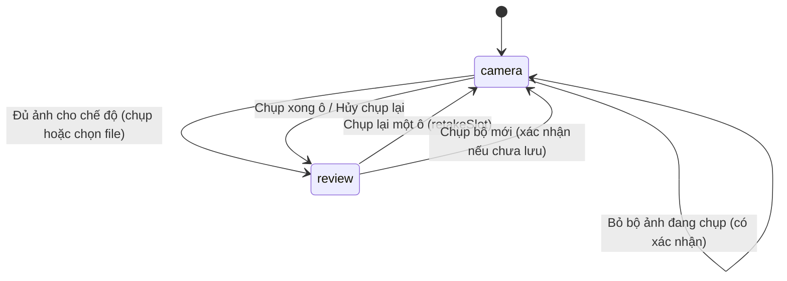

# Kiến trúc và luồng trạng thái

Đối chiếu source ngày **2026-11-02** (sau đợt redesign camera-first). Điểm vào: `src/main.tsx` → `App.tsx`. Không có router; màn hình chọn bằng state `step`. Không còn trang chào (landing): mở app là vào camera.

## Màn hình và điều hướng

| State | Nội dung và hành vi |
| --- | --- |
| `camera` | Khung ngắm tràn màn hình, dải 7 chế độ (thay bằng cuộn ảnh khi đang chụp dở), công cụ nổi Khung, Lọc, Hẹn giờ, Tự chụp/Từng tấm; chọn ảnh từ máy; đổi camera. Khi đếm ngược, `.app.is-counting` ẩn các điều khiển |
| `review` | Bản xem trước tờ ảnh (cùng hình học với PNG), chạm ô để chụp lại/lưu riêng, tab Khung · Lọc · Bố cục · Dấu · Giấy, lưu PNG, sao chép, lưu từng tấm, chụp bộ mới |

Quyền camera được theo dõi bằng `watchCameraPermission` (Permissions API): `granted` tự mở camera, `denied` hiện ngay hướng dẫn mở lại theo trình duyệt (`detectBrowser`: Chrome, Edge, Safari, Firefox, iOS, Android) kèm mã `PermissionState · denied`, và khi người dùng bật lại quyền thì camera tự mở. Lỗi `Permission denied by system` (macOS/Windows chặn trình duyệt) có thông báo riêng; trang trong iframe bị từ chối thì báo `cameraEmbedded` và có nút mở tab mới.

Trong `camera`, cổng camera (`vf__gate`) hiện khi chưa có stream: lời mời "Mở camera" (cần thao tác người dùng), trạng thái đang mở, hoặc lỗi có nút Thử lại, Chọn ảnh từ máy và hướng dẫn bật quyền (Radix Dialog). Nếu Permissions API báo camera đã `granted`, app tự mở camera khi tải; trình duyệt không hỗ trợ truy vấn này (Firefox, Safari cũ) vẫn cần một chạm.

## Thành phần

| File | Trách nhiệm |
| --- | --- |
| `App.tsx` | Toàn bộ state, vòng đời camera và quyền, đếm ngược/tự chụp, nhập file, lưu/sao chép, toast, hộp xác nhận bỏ ảnh, thanh trên (logo hoặc nút bỏ ảnh, âm thanh, Cài đặt) |
| `components/SettingsSheet.tsx` | Ngôn ngữ, âm thanh, cài app, hướng dẫn camera |
| `components/CameraScreen.tsx` | Khung ngắm có mặt nạ ô in, cột dải ảnh (chế độ Dải 4), thanh chế độ, hàng công cụ và khay chọn, thanh nút chụp, `HelpDialog` |
| `components/ReviewScreen.tsx` | Sân khấu tờ ảnh, thao tác từng ô, tab công cụ, thanh hành động |
| `components/PrintPreview.tsx` | Bản DOM của PNG, vị trí lấy từ `getPrintLayout` |
| `components/Tools.tsx` | Các rail chọn: khung, lọc, bố cục, dấu + ghi chú, chất giấy |
| `lib/photo.ts` | Đọc file, tính vùng chụp, capture, dựng PNG, tải, clipboard |

## Camera và bộ đếm

- `startCamera()` dừng stream cũ, xin `facingMode`, lý tưởng 1280×960, `audio: false`. `requestRef` vô hiệu hóa request cũ; stream trả về muộn bị dừng.
- `stopCamera()` hủy interval đếm ngược, timeout tự chụp, dừng track. Rời sang `review` và unmount đều dừng stream.
- Cài đặt dùng trong timer (hẹn giờ, tự chụp, âm thanh, camera trước/sau, ô chụp lại, chế độ) đọc từ ref `latest`, nên đổi giữa chừng có hiệu lực cho tấm kế tiếp.
- Bấm nút chụp khi đang đếm ngược hoặc đang chờ tấm tự động kế tiếp sẽ hủy chúng.
- Tự chụp: mỗi tấm xong chờ 1400ms rồi đếm tiếp. Đủ ảnh thì sang `review`.
- Chụp lại: `retakeSlot` thay đúng ô đó rồi về `review`. "Hủy chụp lại" về `review` giữ ảnh cũ.
- Đổi chế độ chỉ được khi chưa có ảnh nào; đổi sẽ tạo mảng ô trống theo số ảnh của chế độ. Ở `review`, tab Bố cục chỉ đổi giữa các bố cục cùng số ảnh (Dải 4 ↔ Lưới 2×2).
- Mở camera qua `src/lib/camera.ts` (`openCameraStream`): thử lần lượt (1) `facingMode` + lý tưởng 1280×960, (2) chỉ `facingMode`, (3) `video: true` khi gặp `OverconstrainedError`, `NotReadableError`, `AbortError`, `TypeError`.
- Lỗi được phân loại (`classifyCameraError`) và hiện kèm mã lỗi: trang không phải HTTPS/localhost → `cameraInsecure` (`InsecureContext`); không có API → `cameraUnsupported`; `NotAllowedError`/`SecurityError` → `cameraDenied`; `NotReadableError`/`AbortError` → `cameraBusy`; còn lại → `cameraNotFound`. `AbortError` từ `video.play()` do đổi nguồn không bị coi là lỗi.
- Trong lúc chờ, cổng camera nhắc chọn Cho phép trong hộp hỏi quyền của trình duyệt.

## Nhập file local

Một input ẩn dùng chung (`multiple` khi chế độ cần 4 ảnh). Đọc bằng FileReader, điền vào các ô trống theo thứ tự, không thay ô đã có. Đủ ảnh thì sang `review`. Lỗi đọc hiện toast lỗi (`role="alert"`) ở mọi màn. Chưa kiểm tra dung lượng, không resize hay xử lý riêng HEIC.

## Cài đặt (PWA)

- `index.html` khai báo manifest, favicon PNG, apple-touch-icon và `apple-mobile-web-app-title`.
- `src/lib/install.ts`: `useInstall()` bắt `beforeinstallprompt` (giữ lại để gọi `prompt()`), `appinstalled`, phát hiện chế độ standalone, iOS và Safari trên Mac; trả `route` = `prompt | ios | mac-safari | null`. `registerServiceWorker()` chỉ chạy ở bản build (`main.tsx`).
- `components/InstallSheet.tsx`: bottom sheet liệt kê lợi ích và các bước cài theo `route`.
- `public/sw.js`: trang dùng network-first, rơi về `/` đã lưu khi mất mạng; `/assets`, `/icons`, `/samples`, `/screenshots` dùng cache-first. Đổi tên `CACHE` khi cần xóa cache cũ.
- `/?mode=single|strip-4|grid-2x2` chọn chế độ lúc mở (lối tắt trong manifest dùng tham số này).

## Lưu trữ và mạng

- `photos: Array<string | null>` dài đúng số ảnh của chế độ; giữ data URL trong bộ nhớ. Tải lại trang là mất.
- `shotDate` ghi lúc tấm đầu tiên của bộ được chụp/nhập; dấu ngày giờ trên preview và PNG đọc cùng giá trị này.
- Chỉ ngôn ngữ được lưu (`localStorage.moyoo_lang`); đọc và ghi đều bọc try/catch.
- Font Baloo 2 được đóng gói qua `@fontsource-variable/baloo-2`, không tải từ Google Fonts. App không gọi mạng nào ngoài việc tải chính nó; sau lần đầu, bản cài mở được khi mất mạng.
- Không có tài khoản, backend, database hay analytics. Service worker chỉ lưu vỏ app (HTML, JS, CSS, font, icon, ảnh mẫu).
